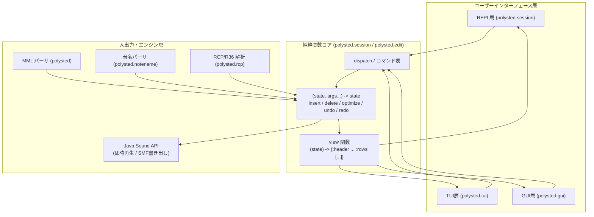

# polysted — STED2 に強い影響を受けた MIDI ステップエディタ／シーケンサ（Clojure）

X68000 で広く使われた MIDI シーケンサ **STED2**（作者: 故 TURBO 氏 / 戸田貴之氏）の入力方式とデータ構造を、**Clojure** で作り直した MIDI ステップエディタ／シーケンサです。

STED2 の「**4 バイト固定長レコード (`[b0 b1 b2 b3]`)**」によるデータ表現をそのまま採用し、そのレコードを扱う純粋関数のコアを、**REPL**・**TUI**（端末）・**GUI**（ウィンドウ）の三つの入口から使えるようにしています。

> polysted は STED2 の公式の後継や移植ではなく、STED2 に学んで作り直した**亜種（variant）**です。原作のソースコードは含んでいません。原作を指す「STED2」の名前と記述は、そのまま使っています。

## 名前について — polysted

**poly**（多くの）+ **STED**。この名前には二つの意味を込めています。

1. **ひとつのコアの上の、複数のインターフェース**
   同じ純粋関数のコア（4 バイトのレコードを受け取って、新しいレコードを返す関数）を、REPL・TUI・GUI の三つの入口から使います。
2. **多くの人の手を渡ってきた系譜への、敬意と感謝**
   カモンミュージックのレコンポーザが形作った RCP の世界。故 TURBO 氏（戸田貴之氏）が生み出した STED2。作者亡き後、ご両親の承諾を得てソースを公開した「ゆいＮＥＴ」の方々。そして、ソースの保存・公開や、形式の解析・変換ツールを通じて、その遺産を受け継いできた多くの人たち。polysted は、こうした人々の仕事に強く影響を受けて生まれました。

## 目次

- [はじめての操作（5 分ガイド）](#はじめての操作5-分ガイド)（ウィンドウで使うなら `clojure -M:gui`）
- [名前について](#名前について--polysted) / [背景と設計思想](#背景と設計思想) / [ファイル構成](#ファイル構成) / [必要環境](#必要環境)
- [クイックスタート](#クイックスタート)（REPL・TUI・音名入力・RCP・SMF）
  - TUI: [トラック設定画面](#トラック設定画面tab-で切り替え原作のメイン画面-trkset) / [リズムパターン編集](#リズムパターン編集ctrl-g原作のリズムトラックエディタ) / [直接入力モード](#直接入力モード-で切り替え)
- [データモデルとレコード仕様](#データモデルとレコード仕様) / [入力記法リファレンス](#入力記法リファレンス)
- [REPL コマンドリファレンス](#repl-コマンドリファレンス-polystedsession)
- [用語解説](#用語解説)（K# ST GT VEL、小節線、SAME、コントローラ、ワンタッチ入力）
- [実装状況と今後の予定](#実装状況と今後の予定) / [トラブルシューティング](#トラブルシューティング) / [参考文献](#参考文献関連資料) / [ライセンスと原作の文書](#ライセンスと原作の文書)

## はじめての操作（5 分ガイド）

```bash
cd polysted
clojure -M:tui my_song.edn         # 新しい曲を TUI で開く（保存先は my_song.edn）
```

1. **音を入れる**: `n` を押して `C4 E G C5` と打ち、`Enter`。カーソル位置に 4 音が入ります（`m` なら MML: `l8 cdefgab<c`）。
2. **STED2 風に 1 行ずつ入れる**: `:` で直接入力モード。`Enter` で空欄の行ができ、`C4` `Space` `48` `Enter` のように K# → ST と入れていきます。`F5`（または `Alt+5`）で 4 分音符の長さ。
3. **直す**: `↑↓` で行を選び、`x` で削除、`u` で元に戻す。直接入力モードでは数字や `+` `-` で欄の値を変えられます。
4. **聴く**: `p` で最初から、`P` でカーソルの小節から再生。もう一度 `p` で停止。
5. **保存する**: `w` → `Enter`（拡張子で形式が決まります: `.edn` は EDN、`.rcp` / `.r36` は RCP、`.mid` は SMF）。`q` で終了。

困ったら `?` でキーの一覧が出ます。トラックのチャンネルや曲のテンポは `Tab` のトラック設定画面、ドラムは RHY を ON にしたトラックで `Ctrl-G` のリズム画面が便利です。

---

## 背景と設計思想

### 1. 夭折の天才開発者 TURBO 氏と STED2 の遺志
STED2 の作者である TURBO 氏（戸田貴之氏）は、進行性筋ジストロフィと戦いながら車椅子の上で情熱を燃やし、1997年に29歳で逝去されました。作者亡き後、草の根BBS「ゆいＮＥＴ」の有志によって愛用マシンからソースコードが抽出され、「彼の遺志を継いでくれる方へ」という願いと共に一般公開されました。
本作は、その歴史的遺産である C 言語／アセンブラ版 STED2（[cat2151/STed2.07m](https://github.com/cat2151/STed2.07m)）のソースを読んで仕様を確かめ、その設計思想に学んで Clojure で作り直すプロジェクトです。ソース公開時の文書（`追悼.DOC`・`STED207M.HIS`）は、[`doc/original/`](doc/original) に原文のまま同梱しています。

### 2. 「休符もタイも専用コードがない」ミニマリズムの極致
STED2 のトラックデータは、4バイトの整数ベクタ `[b0 b1 b2 b3]`（ノートは `[キー ST GT vel]`）のみで構成されます。
- **休符の非存在**: 専用の休符コマンドを持たず、発音長 (`GT`) または音量 (`vel`) が 0 のノートを休符として評価します（正規形は `[0 ST 0 0]`）。
- **タイの非存在**: 専用のタイコマンドを持たず、`GT > ST`（次の発音タイミングを超えて音が響き続ける状態）をもってタイを表現します。最適化処理（`tai_compres`）では、後続の同音ノートの長さを前のノートの GT に合算し、後ろを休符化する「タイ圧縮」を行います。
- **和音の表現**: ST=0 のノートを連続させることで、同一タイミングでの多声発音を表現します。

### 3. 純粋関数コアとマルチ UI アーキテクチャ
すべての編集操作は `(state, args...) -> state` の純粋関数として実装されています。また、画面状態をデータ構造として返す `view` 関数を中核に置くことで、**REPL**、**TUI**（ターミナルUI）、**GUI**（Swing のウィンドウ）から全く同一のコアロジックを共有します。GUI は TUI の画面の行とキー処理をそのまま使い、描画・メニュー・マウスだけを持ちます。



---

## ファイル構成

ソースは `src/polysted/` にあり、ファイル `src/polysted/xxx.clj` が名前空間 `polysted.xxx` です（`tui_base.clj` は `polysted.tui-base`）。

| ファイル | 役割 |
|---|---|
| [`src/polysted/mml.clj`](src/polysted/mml.clj) | `polysted.mml`: MML パーサ、調号シフト、SAME/ループ展開、絶対 tick 化、SMF (`.mid`) 書き出し |
| [`src/polysted/rcp.clj`](src/polysted/rcp.clj) | RCP/R36 の読み込み（4バイトレコードとヘッダの全項目）と書き出し (`write-rcp!`)、イベント変換、SMF 直接出力 (`rcp->mid!`) |
| [`src/polysted/edit.clj`](src/polysted/edit.clj) | レコード編集コア（挿入・削除・置換）、タイ圧縮 (`tai_compres`)、トラック最適化 (`trk_opt_sub`) |
| [`src/polysted/edn.clj`](src/polysted/edn.clj) | 曲データの EDN 保存・読み込み（1行1レコード、形式・レコードの検査付き） |
| [`src/polysted/replace.clj`](src/polysted/replace.clj) | 置換・指定削除・検索マクロ（原作の F3 / Shift+F3 / F4・F5 の書式） |
| [`src/polysted/rhythm.clj`](src/polysted/rhythm.clj) | リズムパターン編集の変換（小節 ⇔ ステップ×楽器の格子、原作 REDIT.C の rtopat / pattor） |
| [`src/polysted/ctrl.clj`](src/polysted/ctrl.clj) | コントローラ記号・MIDI チャンネル・調・エクスクルーシブなどの値の解釈と表示（セッション状態を使わない純粋関数。`src/polysted/session.clj` から分割） |
| [`src/polysted/smf.clj`](src/polysted/smf.clj) | SMF (.mid) の読み込み → レコード形式（チャンネルごとにトラックを分け、PPQ をタイムベースに換算） |
| [`src/polysted/session.clj`](src/polysted/session.clj) | UI 非依存の編集セッションコア、`view` 生成、REPL 対話層、Java Sound 演奏制御 |
| [`src/polysted/notename.clj`](src/polysted/notename.clj) | 音名入力パーサ（STED2 `KEY_SUB.C` の `ctc` 仕様準拠: `C4 E G`, `#`, `+`, `-`, `B`, `N`, `=`, `<`, `>`, `.`, 16進など） |
| [`src/polysted/tui_base.clj`](src/polysted/tui_base.clj) | TUI の土台（端末の入力の解読・UI の状態・画面で共通の小さな関数。純粋関数） |
| [`src/polysted/tui_screens.clj`](src/polysted/tui_screens.clj) | TUI の補助の画面（トラック設定・リズム・ワンタッチ表・USER EXC・エクスクルーシブの表示のキー処理と描画） |
| [`src/polysted/tui.clj`](src/polysted/tui.clj) | TUI 層（キー解読・キー割り当て表・画面の行は純粋関数、端末ループは `run!`） |
| [`doc/機能目録.md`](doc/機能目録.md) | **機能目録**: 41 の機能ごとに、操作・実装の場所・原作の根拠・Clojure の学習ポイント・章立ての案・改善の候補。改造の地図と連載の章立て案つき |
| [`dev/user.clj`](dev/user.clj) | REPL の user 名前空間（`clojure -M:repl` / `clojure -M:dev` で自動で読み込まれ、`s` が `polysted.session` の別名に） |
| [`deps.edn`](deps.edn) / [`repl.bb`](repl.bb) | 起動のエイリアス: `clojure -M:tui [file]`・`-M:gui [file]`・`-M:repl`（rebel-readline）・`-M:dev`・`-M:check`、`bb repl.bb [--plain]` |
| [`src/polysted/check.clj`](src/polysted/check.clj) | 全部の名前空間の簡易チェック（`run-checks`）を順に実行する（`clojure -M:check`、NG があれば終了コード 1） |
| [`src/polysted/gui.clj`](src/polysted/gui.clj) | GUI 層（Swing。画面とキー操作は TUI と共通、メニュー・ファイル選択・マウス・ウィンドウの大きさに追従） |
| [`src/polysted/visual.clj`](src/polysted/visual.clj) | コントローラのビジュアルエディットの計算（種類の解釈・点の読み込み・波形・行への書き出し。純粋関数） |
| [`src/polysted/score.clj`](src/polysted/score.clj) | 楽譜表示の計算（音符の種類・高さと臨時記号・要素の並び。純粋関数、原作 SCORE.C） |
| [`src/polysted/record.clj`](src/polysted/record.clj) | レコーディングの変換（MIDI 入力 → レコード、トラックへの書き込み。純粋関数、原作 RECORD.C） |
| [`src/polysted/roll.clj`](src/polysted/roll.clj) | ピアノロールの計算（音符の位置・小節線・クリックの当たり判定・表示範囲。純粋関数） |
| [`実装状況と仕様.md`](実装状況と仕様.md) | STED2 の C ソースの解析に基づく仕様の調査（【確認】【推測】【設計判断】の区別つき）、実装状況、検証ログ |
| [`samples/summarize.clj`](samples/summarize.clj) | RCP ファイルの中身を要約する診断スクリプト（サンプルの曲データは同梱していません） |
| [`doc/original/`](doc/original) | 原作 STED2 のソース公開時の文書（`追悼.DOC`・`STED207M.HIS`。原文と UTF-8 の読み物版） |
| [`LICENSE`](LICENSE) | polysted のライセンス（MIT） |
| [`CLAUDE.md`](CLAUDE.md) | 開発の手順のメモ（Claude Code で開発するときの指示を兼ねる） |

---

## 必要環境

- **Java**: OpenJDK 17 以上 (OpenJDK 21 推奨)
- **Clojure CLI**: 1.11 以上
- **REPL ツール (推奨)**: `rebel-readline`（行編集・補完用: `clojure -M:repl`。`deps.edn` から自動で取得）

---

## クイックスタート

### 1. REPL での対話的編集と再生

**起動**（全部の名前空間を読み込んでから REPL を開きます。`s/` が `polysted.session` の別名になります）:

```bash
clojure -M:repl            # rebel-readline の REPL（行編集・補完）
clojure -M:dev             # 普通の REPL
bb repl.bb                 # babashka から（clojure -M:repl と同じ。--plain で clojure -M:dev）
```

- REPL の user 名前空間は [`dev/user.clj`](dev/user.clj) です（起動時に自動で読み込まれ、最後に使い方を表示します）。
- `:repl` エイリアスは rebel-readline 0.1.4 を使います（初回は取得に少し時間がかかります）。
- GUI（`polysted.gui`）は画面が使えない環境では読み込みに失敗するので、その場合は警告だけ出して続けます。
- ChromeOS の Linux では `DISPLAY` が `wayland-0` になっていて Java の画面が開けません。`bb repl.bb` は、`DISPLAY` が X11 の形でなければ `DISPLAY=:0` を付けて起動します（`clojure` を直接使うときは `DISPLAY=:0 clojure -M:repl` のように付けてください）。
- ほかの REPL（エディタの nREPL など）からは `(require '[polysted.session :as s])` で使えます（`deps.edn` の `:paths` が `src`）。

```clojure
;; 1. MML を入力してトラックに追加
(s/mml "o4 l8 c d e f g a b < c")

;; 2. 現在のトラック状態を表示
(s/show)
; TR01 ch=1 tempo=120 pos=8/8
;      0  C4        24  22  64
;      1  D4        24  22  64
;      2  E4        24  22  64
;      3  F4        24  22  64
;      4  G4        24  22  64
;      5  A4        24  22  64
;      6  B4        24  22  64
;      7  C5        24  22  64
; >    8  <END>

;; 3. バックグラウンドで即時プレビュー再生
(s/play!)

;; 停止
(s/stop!)

;; 4. Standard MIDI File (.mid) として書き出し
(s/save-mid! "my_song.mid")

;; 5. 曲データを EDN で保存・読み込み（保存形式の正）
(s/save! "my_song.edn")
(s/load! "my_song.edn")
(s/save!)                 ; 2回目以降はパス省略で同じファイルへ
```

### 2. TUI（全画面エディタ）

ターミナルで全画面の編集画面を開きます。REPL と同じセッションを使うので、`q` で抜けると REPL に戻り、続きを `s/show` などで操作できます。

```bash
clojure -M:tui                  # 空の曲で起動
clojure -M:tui song.edn         # EDN を開く（w で同じファイルに保存）
clojure -M:tui song.rcp
clojure -M:tui song.mid         # SMF を開く
```

```clojure
(s/tui)   ; REPL から
```

| キー | 動作 | キー | 動作 |
|---|---|---|---|
| `↑` `↓` / `k` `j` | カーソル移動 | `PgUp` `PgDn` | 1画面移動 |
| `Home` `End` / `g` `G` | 先頭 / 末尾 | `←` `→` / `Ctrl+←` `Ctrl+→` | 前後のトラック |
| `n` / `Enter` | 音名入力（`C4 E G`） | `m` | MML 入力（`l8 cdefg`） |
| `x` / `Delete` | カーソル位置を1つ削除 | `u` / `Ctrl-R` | 元に戻す / やり直し |
| `o` | 最適化 | `p` / `Space` | 再生 / 停止 | | |
| `P` | カーソルのある小節から再生（ポイントプレイ） | `Ctrl-X mplay` | カーソルの小節だけを編集中のトラックで再生（小節プレイ） |
| `w` | 保存（拡張子で EDN / RCP / R36 / SMF） | `?` | ヘルプ |
| `q` | 終了（未保存なら確認） | `Ctrl-L` / `Insert` | 削除行の復活（最後に 1 行削除した行をカーソル位置へ。端末の大きさの変更は自動で検知） |
| `Tab` | トラック設定画面（下記）と行き来 | `Ctrl-G` | リズムパターン編集（RHY が ON のトラック、下記） |
| `:` | 直接入力モードに切り替え | `*` | カーソル行に小節線を挿入 |
| `[` | リピート開始を挿入 | `]` | リピート終了を挿入（合計の演奏回数を入力） |
| `^` | 小節複写 SAME を挿入（複写元の小節番号を入力） | | |
| `v` / `F6` | 範囲の開始行（もう一度で解除、`Esc` でも解除） | `x` / `F7` | 範囲があれば範囲を削除（クリップボードへ）、なければ1行削除 |
| `y` / `F8` | 範囲を複写（クリップボードへ） | `Ctrl-V` / `F9` | カーソル行に貼り付け（カーソルは貼り付けた先頭に残る） |
| `Ctrl-D` / `F10` | カーソル行を二重化 | `/` | コントローラ（音量・ベンド・音色など）を挿入 |
| `BS` | 上の行を削除 | `Ctrl-Y` | カーソル行を削除 |
| `_` | トラックエクスクルーシブを入力（カーソル行が Tr.Exclu なら書き換え） | `Ctrl-X uex n データ` | ユーザーエクスクルーシブ n の表を設定 |
| `}` | ワンタッチ表（ST/GT ASSIGN、下記） | `Ctrl-U` | ユーザーエクスクルーシブの表（USER EXC、下記） |
| `E` | エクスクルーシブの表示（カーソルの Tr.Exclu か U0〜U7 のデータ、下記） | | |
| `Ctrl-X excload ファイル` | `.EXC`（テキスト）を読んでトラックエクスクルーシブに（カーソルが Tr.Exclu なら置き換え） | `Ctrl-X excsave ファイル` | カーソルの Tr.Exclu を `.EXC` に書き出す |
| `Q` | クオンタイズ（解像度 2〜48・レート 50〜100%。範囲が無ければカーソルから最後まで） | `Ctrl-E` / `Shift+F1` | ノート操作（下記） |
| `Ctrl-T` / `F3` | 置換（下記） | `Ctrl-K` / `Shift+F3` | 指定削除 |
| `Ctrl-X` | コマンド欄（`same` / `same all`: 重複した小節を SAME に、`extract`: SAME を展開、`repeat` / `repeat all`: 繰り返しをリピートに圧縮、`rev` / `mix`、`mplay`: 小節プレイ、`uex n データ`、`ras 番号 キー GT 名前`: リズム割り当て） | `Ctrl-^` | SAME を展開（範囲が無ければトラック全体） |
| `Ctrl-F` / `F4` | 検索の指定（して次へ） | `Ctrl-N` / `F5`、`Ctrl-P` / `Shift+F5` | 次を検索 / 前を検索 |
| `Shift+F9` / `Ctrl-X rev` | 反転貼付（クリップボードを前後逆にして貼り付け） | `M` / `Shift+F8` / `Ctrl-X mix` | ミックス貼付（カーソル以降のデータに時刻順に混ぜる） |
| `r` | レプリケート（`トラック 開始小節 終了小節 回数 キーシフト` → カーソル位置へ） | `R` | 全トラックのレプリケート（`開始小節 終了小節 回数 キーシフト` → カーソルの小節へ） |
| `t` | 範囲（`v`）を `トラック 小節 回数 キーシフト` へコピー | `T` | 範囲を全トラック（ch が OFF でないもの）の `小節 回数 キーシフト` へ |

**置換・指定削除・検索**（`Ctrl-T` / `Ctrl-K` / `Ctrl-F`、原作の F3 / Shift+F3 / F4）: 原作と同じ書式です。範囲が無ければカーソルから最後まで。

書式は `検索{:置換},…` を NOTE・ST・GT・VEL の順に並べ、`|` で区切ると複数を順に実行します。

| 指定例 | 動作 |
|---|---|
| `C4:D#4` | C4 を D#4 に |
| `:+12` | 全ノートを1オクターブ上に |
| `,,,:+10` / `,,,10:20` | ベロシティを +10 / ベロシティ 10 だけ 20 に |
| `,,:/2` / `,:*2,:*2` | GT を半分 / ST と GT を 2 倍（255 を超えたら休符で足す） |
| `,,,:-64*1.2+64` | ベロシティを 64 を中心に 1.2 倍 |
| `64>,,,:+20` / `,,,100<:+5` | キー 64 未満のベロシティ +20 / ベロシティ 100 より大きいものを +5 |
| `C*:+1` / `48_59,,,:100` | すべての C を半音上 / キー 48〜59 のベロシティを 100 |
| `,,!6:8` | GT が 6 以外を 8 に |
| `%60_71:+12` | 元を残して 1 オクターブ上を重ねる |
| `/G,,10:16` / `/P,,:*2` | 音色 10 を 16 に / ベンドを 2 倍 |
| `/V:/E` / `/E,,,80_100:120` | ボリュームをエクスプレッションに / エクスプレッション 80〜100 を 120 に |
| （削除）`/S` / `@!36` | 全コントローラを削除 / C2 以外を同じ ST の休符に |
| `,,&,:1` | タイの音だけベロシティを 1 に（`!&` はタイでない音） |

置換の値は `+ - * / %` の式を左から順に計算し、`a_b` は a〜b の乱数、`^値` は絶対値、`@0` `@1` `@2` は ST・GT・VEL の値を写します。`$` の文字列検索と ST 欄の `+` `-`（和音の音数）は未対応です。

**ノート操作**（`Ctrl-E` / `Shift+F1`、原作の Shift+F1）: 入力欄にモードと値を書きます。範囲が無ければカーソルから最後まで。

| 入力例 | 動作 |
|---|---|
| `L 40 100` | ベロシティを 40 から 100 へ直線的に |
| `C 60 90` | 和音の中で 60 から 90 へ（単音は 90） |
| `R 70 90` | ベロシティを 70〜90 のランダムに |
| `O -10 10` | 今のベロシティに −10〜10 を足す |
| `T -2 2` | ST と GT に −2〜2 を足す（タイミングを揺らす） |
| `U` / `D` | 和音の音を低い順 / 高い順に並べ替え |
| `G 6` / `S 6` | 和音を合計 ST 6 かけてずらす（ストラム。`G` は鳴り終わりもそろえる） |

範囲は「開始行とカーソル行の間」で、**下側の行は含みません**（原作どおり）。範囲の行には `|` 印と下線が付き、見出しに `[範囲 n 行]` と出ます。複写・削除では SAME を中身に展開してクリップボードに入れ、削除・貼り付けで小節の数が変わると、後ろの SAME の参照を自動で直します。

表示は STED2 のエディット画面と同じ `MEAS STEP: NOTE K# ST GT VEL` の形です（MEAS は小節の先頭行だけ、STEP は和音の途中では増えない、GT の後の `*` はタイ）。

#### トラック設定画面（`Tab` で切り替え、原作のメイン画面 TRK.SET）

曲の設定（TITLE・TEMPO・TIMEBASE・BEAT・KEY・PLAYBIAS）と、トラックごとの設定を表で編集します。

| 列 | 内容 |
|---|---|
| TR | トラック番号。`Enter` でそのトラックの編集画面へ |
| MODE | Play / Mute / Mix / Rec（`Enter` で順に、`=` で Mute の切り替え）。Mix・Rec は録音するトラック（下記） |
| CH. | MIDI チャンネル（A1〜A16、B1〜B16、0 = OFF）。`=` で A/B を切り替え |
| ST+ | 演奏のタイミング（−99〜99） |
| K#+ | 音程のシフト値（−64〜63、OFF） |
| RHY | リズムトラック（OFF → ON → ON+、`Enter` で切り替え） |
| TRACK MEMO | コメント（36 文字） |
| STEP / TOTAL ST | レコード数 / ST の合計（表示のみ。255/256 回のループは1回として数える） |

`↑↓←→` で欄を選び、`Enter` で入力、`+` `-` で 1 ずつ増減、`Space` で OFF / 0、`a` でトラックを追加します。KEY は `G` `Bb` `Am` のような音名（`m` で短調）か 0〜31 で入力します。ST+（タイミング）と K#+（音程）は再生と SMF 書き出しに反映されます（K#+ が OFF のトラック、たとえばリズムトラックはずらしません）。

#### レコーディング（`Ctrl-X rec`、GUI は「再生」メニューにも。原作の REALTIME RECORDING）

MIDI キーボードなどの入力を、MODE が **Mix**（既存のデータに混ぜる）か **Rec**（録音する小節を置き換える）のトラックへ録音します。

1. `Tab` のトラック設定画面で、録音するトラックの MODE を `Enter` で Mix か Rec にします（Rec のトラックは録音中も鳴りません）。
2. `Ctrl-X` で `rec` と入力すると、録音の画面になります。`C` 録音チャンネル、`O` 入力をそのまま音源へ出す（THRU）、`M` メトロノーム、`S` 録音する小節（開始 終わり）を設定します。
3. `Enter` か `Space` で開始します。1 小節目からなら 2 小節のカウントの後から録音します。ほかのトラック（Play・Mix）とメトロノーム（ch16 のキー 64、拍頭が強い）が鳴ります。
4. `Esc`（か `Enter`・`Space`）で止めると、録音したデータをトラックに書き込みます（`u` で元に戻せます）。終わりの小節に達すると演奏は止まり、`Esc` で取り込みます。
5. **録音したトラックを聴くときは、MODE を Play か Mix に戻します**（原作どおり Rec と Mute のトラックは再生で鳴りません）。取り込んだときと、鳴らないトラックで再生を始めたときに、メッセージ行に案内が出ます。

- 録音するトラックが 1 つなら録音チャンネルの入力を、複数ならそれぞれのトラックのチャンネルの入力を入れます。
- ノートはノートオフまでを GT にし、小節線を入れ、最後にタイ圧縮をかけます。コントロールチェンジ・プログラム・ベンド・アフタータッチ・エクスクルーシブ（Roland の DT1 は DF DD DE の行）も入れます。
- MIDI 入力の機器は Java（javax.sound.midi）が見つけたものの最初の 1 つを使います。見つからなければメッセージが出ます。

#### リズムパターン編集（`Ctrl-G`、原作のリズムトラックエディタ）

トラック設定で RHY を ON にしたトラックで、カーソルのある小節を「ステップ × 楽器」の格子で編集します。楽器はリズム割り当て表の 32 音（表が空なら SC55.DEF の既定: Acou BD 36、Acou SD 38、Clsd HiHat 42 など）で、`Tab` で前半・後半の 16 音を切り替えます。

| キー | 動作 |
|---|---|
| `0`〜`9` | 音の強さ（0 = なし、1〜9 = ベロシティ 14・28・…・112・127）。ST の行では ST を入力 |
| `Space` `+` / `-` | 強さを順に変える（ST の行では ST を ±1、`>` `<` は ±10） |
| `Enter` | ベロシティ（0〜127）か ST を直接入力 |
| `PgUp` / `PgDn`、`Home` `F1` / `End` `F2`、`j` | 前後の小節、最初 / 最後の小節、番号を指定して移動 |
| `x` `F7` / `y` `F8` / `Ctrl-V` `F9` | 小節を切り取り / 複写 / 今の小節の前に貼り付け（後ろの SAME の参照も直す。SAME の小節は中身にして写す） |
| `n` / `N` | 末尾に新しい小節（`N` は 1 ステップの ST を指定: 6〜96、192） |
| `a` | カーソル行の楽器の割り当てを変える（`キー GT 名前`、例 `35 1 Kick`。キー 0 は無し）。キーを変えると RHY が ON の全トラックの音も新しいキーに書き換わる |
| `Delete` / `Ctrl-D` | ステップの削除 / 二重化 |
| `Ctrl-L` / `Insert` | 最後に削除したステップをカーソル位置に戻す |
| `m` / `P` | この小節を再生 / この小節から再生 |
| `Esc` / `Ctrl-G` | 編集画面に戻る |

空の最後の小節は「1 小節の ST ÷ ステップの ST」個の空ステップで始まります（4/4・タイムベース 48 なら 16 ステップ）。コントローラなどの行は `*` のステップとしてそのまま残ります。

#### ワンタッチ表（`}`、原作の ST/GT ASSIGN）

直接入力モードの F1〜F10（ワンタッチ入力）で入る ST・GT・VEL の表を変えます。原作どおり曲には保存せず、新しい曲や起動し直しで既定（ST 192 144 96 72 48 36 24 18 12 6 など）に戻ります。

| キー | 操作 |
|---|---|
| `↑` `↓` `←` `→` | F1〜F10 と ST・GT・VEL の欄を移動 |
| `Enter` / 数字 | 値を入力（ST・GT は 0〜255、VEL は 0〜127） |
| `+` `.` / `-` `,` / `>` / `<` | ±1 / ±12 |
| `Space` / `Ctrl-L` | その欄 / 全部を既定に戻す |
| `Esc` / `}` | 編集画面に戻る |

#### ユーザーエクスクルーシブの表（`Ctrl-U`、原作の USER EXC）

`/` の `U0`〜`U7` で送る 8 個のエクスクルーシブ（名前 24 文字・データ 24 バイト）を編集します。曲（RCP のヘッダ）に保存されます。原作の `?` はこの画面ですが、ここではヘルプに使っているので `Ctrl-U` にしました。編集画面のカーソルが U0〜U7 の行なら、その番号から開きます。

| キー | 操作 |
|---|---|
| `↑` `↓` | 番号の名前の行・データの行を移動 / `←` `→` データの位置 |
| `Enter` | 名前の行では名前を入力、データの行では値を挿入 |
| `0`〜`9` `A`〜`F` | その位置を 16 進で上書き（終わり F7 の位置なら挿入） |
| `+` `.` `-` `,` / `>` `<` | 値を ±1 / ±16 |
| `Delete` / `BS` | その位置 / 1 つ前を削除 |
| `F1`〜`F5` / `F6` | `gt` `ve` `ch` `cs` `ss` を挿入 / そこで終わり（F7） |
| `F8` | Roland 形式のチェックサムの値を挿入（5 バイト目から、ヤマハ 43 なら 4 バイト目から、その手前までの合計） |
| `Tab` / `U` | 同じ値を挿入 / ほかの番号から写す |
| `Space` / `Ctrl-L` | その番号 / 全部を空にする |
| `F9` / `F10` | `.REX`（8 個まとめて、RCM 互換の 410 バイト）を読む / 書く。`Shift` を付けると `.RES`（今の番号 1 個、64 バイト） |
| `Esc` / `Ctrl-U` | 編集画面に戻る（変更は `u` で 1 回ずつ戻せます） |

#### 直接入力モード（`:` で切り替え）

（K# ST GT VEL・小節線・ワンタッチ入力などの用語は、後述の [用語解説](#用語解説) を参照）

STED2 のエディット画面の入力方法（`EDIT.C` の `ret()`）を再現したモードです。欄カーソル（反転表示）で K# / ST / GT / VEL を選びます。

| キー | 動作 |
|---|---|
| `Enter` | カーソル行に**空欄の行**を挿入し、K# から入力。何も打たずにもう一度 `Enter` で、上にある一番近いノートの内容が記入される（なければ 60 48 46 64） |
| `A`〜`G` / `0`〜`9` | 既存のノート行ではその欄を上書き（A〜G は K# 欄へ）。END・小節線の上では挿入を始める |
| `←` `→` / `Space` | 欄の移動（左端で前の行の右端、右端で次の行の左端へ） |
| `F1`〜`F10`（`Alt+1`〜`Alt+0`） | ワンタッチ入力（下記） |
| `*` | カーソル行に小節線を挿入（後ろの SAME の参照をずらし、小節番号を振り直す） |
| `[` / `]` | リピート開始 / 終了を挿入。`]` は続けて合計の演奏回数（0〜255、0 と 255 は無限）を入力 |
| `^` | 小節複写 SAME を挿入し、複写元の小節番号を入力（その行より前の小節のみ。SAME の小節は不可） |
| 数字（SAME・`]` の行で） | 欄カーソルが K# 以外なら、小節番号・回数を上書き |
| `/` | コントローラを挿入。記号（下表）を入力して `Enter`、続けて ST と値を順に入力（空のまま `Enter` で今の値） |
| 数字（コントローラの行で） | 欄カーソルの欄（ST・値）を上書き |
| `BS` / `Ctrl-Y` | 上の行を削除 / カーソル行を削除（どちらも後ろの SAME の参照を直す） |
| `v` `x` `y` `Ctrl-V` `Ctrl-D` | 範囲・削除・複写・貼り付け・二重化（通常モードと同じ。直接入力モードの F キーはワンタッチなので、F6〜F10 の代わりにこれらを使う） |
| `Ctrl+←` `Ctrl+→` | 前後のトラック（移動前と同じ小節・同じ時刻の行へ。その小節が無ければ末尾） |
| `+` `.` / `-` `,` | 欄カーソルの値を ±1（`>` / `<` はキー・ST・GT が ±12、VEL・値が ±10。範囲を超えたら反対側へ） |
| `=` | 値の反転（ベンドの正負、パン CC10 の左右、チャンネルの A/B、調の長短） |
| `X` | ワンタッチコード入力（下記） |
| `Esc` / `:` | 通常モードに戻る |
| その他 | `↑` `↓` `PgUp` `PgDn` `Home` `End` `Delete` `x` `u` `Ctrl-R` `o` `p` `w` `q` `?` は通常モードと同じ |

挿入中の欄の進み方（入力を終えたキーで決まる）：

| 欄 | `Enter` | `→` / `Space` | `↓` / `↑` | `←` |
|---|---|---|---|---|
| K# | 行を確定（ST GT VEL は上の行の値） | ST へ | ST へ | 行を確定 |
| ST | 行を確定 | GT へ（ST を変えたら GT の初期値は ST−1） | 行を確定（GT VEL は上の行のまま） | K# に戻る |
| GT | 行を確定 | VEL へ | 行を確定 | ST に戻る |
| VEL | 行を確定 | 行を確定 | 行を確定 | GT に戻る |

- K# は音名（`C4` `E#` `Bb5` `C<`）でもキー番号（`60`、`3CH`、`$3C`）でも入力できます。オクターブを省略するとその行（コピー元）のオクターブです。
- 入力中の行は、確定した欄と打った文字だけが表示されます（原作どおり空欄から）。状態行に、空のまま確定したときに入る値（上の行の値）を表示します。
- `Enter` `Enter` と押すと、上の行と同じ内容の行が入り、カーソルは次の行へ進みます。
- 例: `Enter` `C4` `Space` `24` `Space` `20` `Space` `100` `Enter` → `C4 ST=24 GT=20 VEL=100`
- **ワンタッチ入力**（F1〜F10。F キーの無いキーボードでは `Alt+1`〜`Alt+0`）。値の表は STED2.CNF の既定値：

  | | F1 | F2 | F3 | F4 | F5 | F6 | F7 | F8 | F9 | F10 |
  |---|---|---|---|---|---|---|---|---|---|---|
  | ST | 192 | 144 | 96 | 72 | 48 | 36 | 24 | 18 | 12 | 6 |
  | GT | 188 | 140 | 92 | 68 | 45 | 34 | 22 | 16 | 10 | 5 |
  | VEL | 1 | 15 | 29 | 43 | 57 | 71 | 85 | 99 | 113 | 127 |

  - 入力中の ST 欄: ST と GT が入り、GT 欄で確定待ち（`Enter` で行を確定、`→` で VEL へ）。`Shift+F` なら GT=0（休符）。
  - 入力中の VEL 欄: VEL が入って行を確定。
  - 既存のノート行: 欄カーソルが K#・ST なら ST と GT、GT なら GT、VEL なら VEL を変えて、次のノートへ進む。`Shift+F` で直前の和音の音（ST=0）の GT/VEL もそろえる。
- 例: `Enter` `C4` `Space` `F5` `Enter` → `C4 ST=48 GT=45`（4分音符）
- **ワンタッチコード入力**（`X`、通常モードでも可）: カーソルのノート（小節線・END の上なら 1 行前のノート）をルート音にしてコードに展開します。状態行に構成音が出るので、`←→` で種類（MAJOR 7 maj7 6 maj9 9 7(b9) 7(#9) dim dim7 7(b5) m7(b5) aug aug7 7sus4 69 m9 m6 m7 m）、`↑↓` で転回、`PgUp` `PgDn` でルート音を変え、`Enter` で決定します。F1〜F10 は前半 10 種、Shift+F1〜F10 は後半 10 種。展開した音は元の GT・VEL を受け継ぎ、最後の音が元の ST を持ちます。
- 入力中の `Esc` は、挿入なら行ごと、上書きならその欄の入力を取り消します。1行の入力（または1欄の上書き）が undo 1回分です。

入力欄では `Enter` で確定、`Esc` で取り消し、`Ctrl-U` で全消去。見出し行の `*` は未保存の変更があることを示します。
Linux/macOS のターミナル（`stty` と `/dev/tty`）が必要で、nREPL やエディタ内 REPL からは使えません。

### 2.5 GUI（ウィンドウ）

```bash
clojure -M:gui my_song.edn         # ウィンドウで開く（.rcp / .r36 / .mid も可）
```

REPL からは `(s/gui)`。REPL の `S` を共有するので、REPL で変えた内容はウィンドウをクリックすると反映されます。

- **画面とキー操作は TUI と同じ**です（直接入力・トラック設定・リズム画面・`Ctrl-X` のコマンドもすべて使えます）。F キーは端末と違いそのまま届きます。
- **メニュー**: ファイル（新規・開く `Ctrl-O`・保存 `Ctrl-S`・名前を付けて保存 `Ctrl-Shift-S`・終了 `Ctrl-Q`。ファイル選択ダイアログ付き、拡張子で EDN / RCP / R36 / SMF）、編集（元に戻す `Ctrl-Z`・やり直し `Ctrl-Shift-Z`）、表示（トラック設定・リズム画面）、再生（`F12` で再生 / 停止）、ヘルプ。
- **マウス**: クリックで行を選ぶ、ホイールでスクロール。
- ウィンドウの大きさに合わせて表示行数・桁数が変わります。日本語も等幅で出るよう Noto Sans Mono CJK を使います（無ければ Java の Monospaced）。
- 閉じるときに未保存の変更があれば確認が出ます。

#### ピアノロール（原作には無い GUI 独自の表示）

編集画面の右側に、今のトラックの音を横長の帯で表示します（ウィンドウが狭いときは出ません）。

- 縦が音の高さ（左端に鍵盤と C の位置の音名）、横が時間です。濃い縦線が小節の区切り、薄い線が拍、黄色い縦線がカーソルの位置です。
- 帯の色はベロシティを表します（弱いと青、強いと赤）。カーソルのある音は橙色で、白い枠が付きます。
- **SAME の小節**は参照先の中身を薄い色で展開して表示します。クリックすると SAME の行に移動します。
- **リピートは展開しません**。編集画面の行の並びと同じ順で並ぶので、再生時の時間とずれることがあります。
- ほかのトラックの音は灰色で薄く重ねて表示します（ミュートのトラックは表示しません）。
- **クリック**: 音の上ならその行、何も無い所ならその時刻に鳴っている行へ移動します。
- **Ctrl+ホイール**か `Ctrl+=` / `Ctrl+-` で横に拡大・縮小、`F11` で「ピアノロール → 楽譜 → コントローラのグラフ → 楽譜とグラフ → エクスクルーシブ → なし」を切り替えます（メニューの「表示」にもあります）。
- 縦の範囲はトラックの音域に合わせます。音域が広すぎて収まらないときは、カーソルの音を中央にします。

**ピアノロールでの編集**（どれも `u` で 1 回ずつ元に戻せます）:

| 操作 | 結果 |
|---|---|
| 音をドラッグ | 上下で音の高さ（K#）、左右で時刻を変える（グリッドに合わせる。半升未満の横の動きは時刻を変えない） |
| 音の右端をドラッグ | 長さ（GT）を変える。右端ではマウスカーソルが左右の矢印になる |
| 空き所をダブルクリック | グリッドの升目の頭に音を置く（長さ 1 升、VEL はカーソルの音、無ければ 100） |
| 音を右クリック | 音を消す |

- グリッドはメニュー「表示 → ピアノロールのグリッド」で 4分・8分・16分（既定）・32分・3連8分・なし から選びます。
- レコードの並びは STED2 の形のまま保たれます。音を置くと、その時刻に始まる休符は音に変わります。休符や音の途中に置くと、その行の ST を分けて後ろに入れます。ちょうど音が始まる時刻なら、ST=0 の和音として入ります。
- 音を消すと、直前の行（音か休符）の ST に足して詰めます。直前がコントローラや小節線なら、同じ長さの休符に変えます。どちらの場合も、ほかの音の時刻は変わりません。
- SAME の小節の中（薄い色の音）は編集できません。先に SAME を展開してください（`Ctrl-X extract`）。

#### 楽譜表示（`F11` で切り替え、原作の SCORE.C）

右側の表示を楽譜にすると、今のトラックをト音記号とヘ音記号の大譜表で表示します（原作の編集画面の補助表示「楽譜」を移したもの）。

- 横の位置は ST に比例します（タイムベース 48 換算）。ただし見やすさのため、短い音符でも符頭・旗・臨時記号が重ならない最小の幅を取り、音符は区間の頭に置きます。カーソルの行は橙色で、縦線がカーソルの位置です。
- 音符の種類は長さで決まります（全・付点 2 分・2 分・付点 4 分・4 分・付点 8 分・8 分…64 分）。符尾は上向きで、和音は 1 本にまとめます。
- 高さと臨時記号は調で決まります。調で変化する音は記号なし、調で変化する幹音をそのまま弾くとナチュラル、ほかの黒鍵はシャープです（原作どおり）。
- 調は曲の調（トラック設定の KEY）から始まります。調の変更の行（0xF5）でその小節の残りが変わり、小節線で戻ります。リズムトラックは調号なしです。
- 音の長さには、続くコントローラの行の ST を含めます。休符は続く休符をまとめて 1 つにします（原作どおり）。
- 小節線・リピート（`[` `]`）・SAME（`SAME` の文字）を描きます。SAME とリピートの中身は展開しません。
- クリックでその位置の行へ移動、`Ctrl+ホイール` か `Ctrl+=` / `Ctrl+-` で横に拡大・縮小します。
- 記号のフォントに頼らず図形で描くので、クレフは `G` と `F` の文字で表します。

#### コントローラのグラフ（`F11` で切り替え、原作の SCORE.C gra_special）

楽譜と同じ横軸で、今のトラックの値の変化を描きます（「楽譜とグラフ」では楽譜の下に並べます）。

- ピッチベンド（上位 7 ビット、ピンク）・ボリューム（黄）・エクスプレッション（緑）・モジュレーション（青）・データエントリ（灰の点線）・パン（橙の点線）を段の形で描きます。値は 0〜127 の目盛りです。
- 音は、ベロシティの高さで GT の長さの白い棒になります。GT が ST より長い音（次につながる音）は、右端を下まで落としません。
- その前に値が無いときは、ピッチ中央（64）・ボリューム 100・エクスプレッション 127・モジュレーション 0・データエントリ 0・パン 64 から始めます（原作どおり）。SAME の小節を通ると、参照先の小節の最後の値になります。
- クリックでその位置の行へ移動します。拡大・縮小は楽譜と共通です。

#### エクスクルーシブの表示（TUI・GUI の `E`、GUI は `F11` でも。原作の Exclusive View）

カーソルの行がトラックエクスクルーシブ（Tr.Exclu）かユーザーエクスクルーシブ（U0〜U7）のとき、そのデータを 16 バイトずつの表（行と列の番号付き、`gt` `ve` `ch` `cs` `ss` は名前）で表示します。ユーザーエクスクルーシブは表の名前も出ます。

- データが Roland SC-55 の画面表示（`41 10 45 12 cs 10 xx 00 …`）なら、その中身も表示します。アドレス `10 00 00` は文字（16 文字まで）、`10 01 00` などは 16×16 のドット絵です（GUI は液晶の色で描き、TUI は `##` で表します）。
- TUI の画面では `↑` `↓` で前後のエクスクルーシブの行へ移り、`Esc` で戻ります。GUI の右側の表示はカーソルを追って変わります。

#### コントローラのビジュアルエディット（`V`、原作の VISUAL.C）

ボリュームやピッチベンドなどの値の変化を、グラフの上でマウスでなぞって作ります。GUI の編集画面で `V` を押す（メニュー「編集」にもあります）と、原作と同じ順で聞いてきます。

1. **EDIT MODE**（種類）:
   - `P` ピッチベンド、`V` ボリューム(7)、`E` エクスプレッション(11)、`M` モジュレーション(1)、`N` パン(10)。
   - `C` チャンネルアフタータッチ、`K` ポリフォニックアフタータッチ、`T` テンポ。
   - `1`〜`127` は任意のコントロール番号、`U0`〜`U7` はユーザーエクスクルーシブ、`R` + 番号はローランドのパラメータ。
   - `/記号` は `/` 入力と同じ記号（例 `/H`）、`G` はカーソル行と同じ種類です。
   - `X`（または 0x98 の行で `G`）はトラックエクスクルーシブです。カーソルを 0x98 の行に置いて使い、その行の続きのデータ（F7 の行）を各点に写して、値（`ve` の位置に入る値）を変えていきます。
2. **範囲を選んでいない**とき（新しく作る）:
   - `TOTAL ST`（全体の長さ。既定は 1 拍、カーソルが音ならその ST）と、`COUNT`（点の数。`/4` なら ST÷4、`%50` なら ST の 50%）を聞きます。
   - 点の初期値は、カーソルより前にある同じ種類の最後の値です。無ければボリューム 100、エクスプレッション 127、パン 64 など。
3. **範囲を選んでいる**（`v`）とき: 範囲の中のその種類の行を読み込んで編集します。その種類が無ければ、範囲の長さで新しく作ります。

編集画面の操作:

| 操作 | 内容 |
|---|---|
| ドラッグ | 値を描く（飛ばした点の間は直線でつなぐ）。グラフの上の余白をクリックすると SUB、下の余白はカーソル |
| `←` `→`（`Ctrl` で 6 点ずつ） / `↑` `↓` / `PgUp` `PgDn` | 点の移動 / 値 ±1（ピッチは ±16） / ±10（ピッチは ±682） |
| `0`〜`9` | 値を 数字×14 に（ピッチ以外） |
| `Space` | SUB（波形をかける範囲の片端）を置く・外す |
| `F1` `F2` | 先頭・最後の点へ |
| `Shift+F1` / `Shift+F2` | 値を反転 / 前後を逆に |
| `F3` / `Shift+F3` | 両端を直線でつなぐ / 最小〜最大の乱数 |
| `F5` `F6` `F7`（`Shift` で逆） | 1/4 周期の sin・原作の曲線表・山（`Shift` で谷） |
| `F8` `F9` `F10`（`Shift` で波の数を指定） | sin 波・三角波・矩形波 |
| `X` / `Z` / `I` / `Shift+I` / `D` / `Shift+D` / `C` | ステップを指定の ST 以下に分割 / 全体の ST を伸縮 / 点を挿入 / 点の ST を変更 / 点を削除 / ST を削る / 同じ値の点をつなぐ |
| `Y` | 縦の拡大（ピッチは 1→2→3→6→1 倍で 0 を中心に、ほかは 2 倍でカーソルの値のまわり 64 段） |
| `M` / `Shift+M` | 試し再生: 仮に書き込んだ状態で、始めた位置の小節を編集中のトラックだけ演奏（`Shift` は混ぜた場合）。曲は変わらない |
| `Enter` / `Shift+Enter` / `Esc` | 確定 / 既存のデータに混ぜて確定 / 取り消し |

- 波形は SUB とカーソルの間にかかります。SUB が無ければ全体にかかり、そのとき ST は等分し直されます（原作どおり）。
- **確定のしかた**（どれも `u` で元に戻せます）:
  - 新しく作るとき: `Enter` はカーソル位置に行を挿入します（後ろの時刻はずれます。END の位置なら小節線も入れます）。`Shift+Enter` は既存のデータに時刻順に混ぜます（その時間の中にある同じ種類の行は置き換え）。
  - 範囲を編集するとき: ステップを変えていなければ値だけを書き戻し、変えていれば混ぜます。

### 3. 音名入力 (`polysted.notename`) の利用

STED2 の `ctc` ルーチンに準拠した音名テキストから直接レコードを生成できます：

```clojure
;; セッションのカーソル位置に音名で挿入（長さ・オクターブは直前のノートから引き継ぐ）
(s/n "C4 E G B C5")
(s/n "D E F# X")      ; 無効なトークン X は捨てられ、表示の最終行に「! 無効な音名: X」

;; パーサ単体で使う場合
(alias 'nn 'polysted.notename)

;; 空白またはカンマ区切りの音名列をパース
(nn/parse-notes "C4 E G B C5" {:st 48 :gt 46 :vel 64})
;; => {:records [[60 48 46 64] [64 48 46 64] [67 48 46 64] [71 48 46 64] [72 48 46 64]],
;;     :last-key 72,
;;     :errors []}

;; レコードを直接挿入
(s/ins (:records (nn/parse-notes "G4 A B< C" {})))
```

### 4. 既存 RCP / R36 / G36 ファイルの読み込み・編集・書き出し

```clojure
;; RCP ファイルをセッションに読み込む
(s/open! "song.rcp")

;; 読み込んだ内容を確認
(s/show)

;; そのまま即座に再生
(s/play!)

;; RCP / R36 で書き出す（拡張子 .r36 なら 36 トラック）
(s/save-rcp! "my_song.rcp")
```

SMF (.mid) も `s/open!` で開けます。`(s/open! "x.mid")` のあと `(s/save-rcp! "x.rcp")` で SMF → RCP の変換になります。SMF は 1 つのトラックに複数チャンネルがあればチャンネルごとにトラックを分け（SysEx はトラックエクスクルーシブとして、そのトラックの最初のチャンネルのトラックに入れる）、時間は曲のタイムベース (48) に換算します。間隔が 255 を超えるところは休符で埋め、GT が 255 を超える音は 255 で切ります（メッセージ行に警告）。

TUI では `w` の保存先に `.rcp` / `.r36` を付けると RCP 形式で保存します。原作と同じく常に 18（または 36）トラック分を書き出し、メモ・リズム割り当て・ユーザーエクスクルーシブなどのヘッダの項目は読み込んだものをそのまま書き戻します。

**RCP v3（.G36、レコンポーザ 3.0 の形式）** も読み込めます（`s/open!`、`clojure -M:tui x.g36`、GUI の「開く」。形式はファイルの先頭の見出しで判定します）。原作の STED2 は G36 を読まないので、形式は公開の変換ツール [rcm2smf](https://github.com/shingo45endo/rcm2smf)（MIT ライセンス）のソースで確認しました。STED2 の 4 バイトのレコードに変換して読み込みます:

- ST が 255 を超える行は休符で分け、GT が 255 を超える音は 255 にします（メッセージ行に警告）。
- コメント・エクスクルーシブの続きの行（G36 は 1 行 5 バイト）は 2 バイトずつの行に詰め直します。
- チャンネルはポート 0・1 を A1〜B16 にします。リズム割り当ては先頭の 32 個、ユーザーエクスクルーシブは 24 バイトまで、テンポは 255 までです。
- 保存は `.rcp` / `.r36`（v2 の形式）で行います。G36 での書き出しは未対応です。
- **確認**: 2 つの資料（rcm2smf のソースと、Valley Bell 氏の `RCPFormat.txt`）で形式を照合し、rcp2mid-web-public の合成サンプル `sample_g36.g36` で、見出し・メモ・音符・SMF への書き出し・RCP への保存と読み戻しを確認しました。レコンポーザで作った実際の曲のファイルでの確認は、まだです。

### 5. RCP から SMF (.mid) への直接一括変換

REPL やスクリプトからワンライナーで変換できます：

```clojure
(require '[polysted.rcp :as rcp])

(rcp/rcp->mid! "song.rcp" "out.mid")
```

---

## データモデルとレコード仕様

### 4バイト固定長レコード (`[b0 b1 b2 b3]`)

トラックの内部表現は、整数の 4 要素ベクタの配列です。時間の進行（tick）は `0xF0` 未満のレコードの `b1 (ST)` によってのみ進みます。

| 種類 | `b0` | `b1` | `b2` | `b3` | 説明 |
|---|---|---|---|---|---|
| **ノート** | `0x00–0x7F` | `ST` | `GT` | `vel` | キー番号 (C4=60)、ステップタイム、ゲートタイム、ベロシティ |
| **休符 (正規形)** | `0x00` | `ST` | `0x00` | `0x00` | GT=0 または vel=0 のノートも休符扱い |
| **トラックエクスクルーシブ** | `0x98` | `ST` | gt の値 | ve の値 | データは続く `[F7 0 d d]` 行に2バイトずつ（F0 を含まず F7 で終わる） |
| **ユーザーエクスクルーシブ** | `0x90`〜`0x97` | `ST` | gt の値 | ve の値 | データはヘッダのユーザーエクスクルーシブ表（24 バイト） |
| **Roland デバイス / ベース / パラメータ** | `0xDF` / `0xDD` / `0xDE` | `ST` | デバイス番号 / アドレス上位 / アドレス下位 | モデル ID / アドレス中位 / 値 | `0xDE` で Roland DT1 を送る |
| **バンク付き音色** | `0xE2` | `ST` | `prog` | `bank` | バンク・プログラム指定 |
| **MIDI チャンネル変更** | `0xE6` | `ST` | `ch` | `0` | トラック内でのチャンネル変更 (1〜32) |
| **テンポ変更** | `0xE7` | `ST` | `raw` | `0` | テンポ指定 |
| **コントロールチェンジ** | `0xEB` | `ST` | `ctl` | `value` | コントロールチェンジ (CC) |
| **音色変更** | `0xEC` | `ST` | `prog` | `ch` | プログラムチェンジ |
| **ピッチベンド** | `0xEE` | `ST` | 下位7bit | 上位7bit | 14bit ベンド値 (中心 8192) |
| **調の設定** | `0xF5` | `調` | - | - | 調号バイト指定 |
| **ループ開始 / 終了** | `0xF9` / `0xF8` | `回数` | - | - | ループ区間指定 (`]n` は合計 n 回演奏) |
| **SAME (小節参照)** | `0xFC` | 小節下位 | 小節上位(下位2bit)＋複写元のバイト位置 | 複写元のバイト位置の上位 | 指定小節の内容をそのまま演奏（バイト位置は保存時に計算） |
| **小節線** | `0xFD` | - | 小節番号上位 | 小節番号下位 | 小節区切り（番号は `trk_cluc` が振る） |
| **トラック終了** | `0xFE` | - | - | - | トラック終端 (`<END>`) |

### タイ圧縮 (`tai_compres`) とトラック最適化 (`trk_opt_sub`)

STED2 の真骨頂である最適化ロジック（`s/opt`）を忠実に再現しています：
1. **タイ圧縮**: `GT > ST` のノートの後続に同一キーのノートが存在する場合、後続の長さを前のノートの GT に合算（上限 255）し、後続ノートを休符化します。
2. **休符マージ**: 連続する休符や無音ノートを直前ノートの ST に繰り入れます（上限 240）。
3. **冗長イベント削除**: 連続する同一値のピッチベンドや CC、ST=0 の無音ノートを除去します。

---

## 入力記法リファレンス

### 1. 音名直接入力記法 (`polysted.notename`)
STED2 の `ctc` ルーチンに準拠した直感的な音名入力です：

- **音名**: `C`, `D`, `E`, `F`, `G`, `A`, `B`（大文字・小文字両対応）
- **臨時記号**: `#` または `+`（半音上げ）、`-` または音名直後の `B`（半音下げ）。臨時記号を付けると、曲の調号は使わず幹音から数えます（ト長調でも `F#4` は F#4）
- **調号の打ち消し**: `N` または `=`（調号シフトをキャンセルしてナチュラルに）
- **オクターブ指定**:
  - 数字: `C4`, `D5` 等（最後に現れた数字が有効）
  - `<`（オクターブ上）、`>`（オクターブ下）。記号は左から順に効くので、`C4<` は C5、`C<4` は後の `4` が上書きして C4
  - `.`（オクターブ -1: キー番号 0〜11）
  - **オクターブ省略時**: 直前に入力された音のオクターブを自動継承
- **キー番号直接指定**:
  - 末尾 `H`（例: `3CH` = 60）、または先頭 `$`（例: `$40` = 64）

### 2. MML 記法 (`polysted.mml`、原作 `KEY_SUB.C` の `mml_inp`)
- **音長**: `l4`, `l8`, `l16` 等（1〜64。ST = 192 ÷ n、GT = ST - 2）
- **オクターブ**: `o4`, `o5`、`o.`（−1）、`<`（1オクターブ上）、`>`（1オクターブ下）。0〜9 の範囲で、**以降ずっと有効**（初期値 4）
- **ベロシティ**: `v100`（0〜127）
- **音符・休符**: `c`, `d`, `e`, `f`, `g`, `a`, `b`, `r`。音符ごとの長さ指定も可能（`c8 d16` 等。**その音だけ**有効）
- **臨時記号**: 音名の直後に `#` `+`（半音上げ）、`-`（半音下げ）、`n` `=`（ナチュラル）。付けると調号を使わない。調号はカーソルの小節の調（リズムトラックでは使わない）
- **和音**: `'c e g'48,46`（`` ` `` も可。最後以外の音を ST=0、最終音に指定 ST/GT を適用。16 音まで）
- **ループ**: `[ c d e ]4`（合計 4 回。1〜256、256 は原作と同じく 0 = 無限ループになる）
- ST・GT・VEL の初期値は、カーソル直前のノート／休符から引き継ぎます。テンポ・音色・付点・タイは MML にありません。読めない文字は無視します（`t120` の `t` なども）。

---

## REPL コマンドリファレンス (`polysted.session`)

| コマンド | 引数例 | 説明 |
|---|---|---|
| `s/mml` | `"l8 cdefg"` | カーソル位置に MML をパースして挿入 |
| `s/bar` | - | カーソル位置に小節線を挿入 |
| `s/rep-start` / `s/rep-end` | `- / n` | リピート開始 / 終了（合計 n 回）を挿入 |
| `s/same` | `j` | 小節 j を複写する SAME を挿入 |
| `s/n` | `"C4 E G"` | カーソル位置に音名入力で挿入（ST/GT/vel・オクターブは直前のノートから、調号はカーソルの小節の調: 小節の中の調の変更か曲の設定） |
| `s/ins` | `[[60 48 46 64]]` | レコードのベクタを直接挿入 |
| `s/show` | - | 現在のトラックのレコード一覧を表示 |
| `s/go` | `idx` | 指定行番号にカーソルを移動 |
| `s/mv` | `delta` | カーソルを相対移動 (`+1`, `-5` 等) |
| `s/del` | `[n]` | カーソル位置から `n` レコードを削除（デフォルト 1） |
| `s/cp` | `from to` | `from` 以上 `to` 未満の行をクリップボードにコピー（SAME は中身に展開） |
| `s/cut!` | `from to` | `from` 以上 `to` 未満の行を削除してクリップボードへ（後ろの SAME の参照を直す） |
| `s/pst` | - | カーソル位置にクリップボードの内容を貼り付け（後ろの SAME の参照を直す） |
| `s/dup` | - | カーソル行を二重化 |
| `s/pst-rev` / `s/pst-mix` | - | 反転貼付 / ミックス貼付 |
| `s/rcomp` | - / `true` | 繰り返しをリピート `[ ]n` に圧縮（今のトラック / 全トラック） |
| `s/rpl` | `tr top end times bias` | レプリケート（例: `(s/rpl 1 1 4 2 12)` でトラック1 の小節1〜4 を 2 回、1オクターブ上でカーソル位置へ） |
| `s/same-conv` / `s/same-ext` | - / `from to` | 重複した小節を SAME に置き換え / SAME を展開（省略でトラック全体） |
| `s/rep` / `s/del-match` | `"C4:D#4"` など | 置換 / 指定削除（カーソルから最後まで。書式は下記） |
| `s/fnd` | `"C4"` / - / `"C4" false` | 検索して移動（引数なしは前回の指定で次へ、`false` で前へ） |
| `s/nctl` | `\L 40 100` など | ノート操作（カーソルから最後まで。モードは下記） |
| `s/quan` | `res rate` / `from to res rate` | クオンタイズ（例: `(s/quan 12 100)` でカーソルから最後まで 16分音符に） |
| `s/ctl` | `"V" 0 100` | コントローラを挿入（記号、ST、値…）。例: `(s/ctl "P" 0 -4096)` ベンド、`(s/ctl "G" 0 49)` 音色 49 |
| `s/opt` | - | 現在トラックの最適化（タイ圧縮、休符結合）を実行 |
| `s/un` / `s/re` | - | Undo（元に戻す） / Redo（やり直す） |
| `s/trk` | `tr-no` | 編集対象トラックを切り替え (0〜) |
| `s/newtrk` | `ch` | 新規トラックを追加 |
| `s/tempo` | `bpm` | 曲全体の基本テンポを設定 |
| `s/ch` | `ch-no` | 現在トラックの MIDI チャンネルを設定 |
| `s/open!` | `"path.rcp"` / `"path.mid"` | RCP / R36 / G36 / SMF (.mid) をセッションにロード（SMF は拡張子、RCP 系は見出しで判別） |
| `s/save!` | `["path.edn"]` | 曲を EDN で保存（省略時は最後に load!/save! したファイル） |
| `s/load!` | `"path.edn"` | EDN の曲を読み込む（undo 履歴は消える） |
| `s/new!` | - | 新しい空の曲にする |
| `s/save-rcp!` | `"path.rcp"` | 現在の曲を RCP / R36 で保存（拡張子 `.r36` なら 36 トラック） |
| `s/save-mid!` | `"path.mid"` | 現在の曲を SMF (`.mid`) として保存 |
| `s/play!` | - | バックグラウンドで即時再生を開始 |
| `s/stop!` | - | 再生中のシーケンサを停止 |
| `s/tui` | - | TUI を起動（`q` で REPL に戻る） |

### カーソルと挿入位置

- 挿入系のコマンド（`s/mml` `s/n` `s/ins` `s/pst`）は、**カーソル位置**（`s/show` で `>` の付いた行）に挿入します。カーソル行以降は後ろへずれ、上書きはしません。
- 挿入後、カーソルは挿入したレコードの直後へ進みます。続けて入力すると、その続きに入ります。
- `s/del` はカーソル位置から削除し、カーソルは動きません。`s/cp from to` は `from` 以上 `to` 未満の行をコピーします。
- `s/go` の範囲外の値は端に丸められます。`(s/go 999)` で末尾の `<END>` に移ります。
- `s/open!` `s/load!` `s/new!` `s/trk` の直後は、カーソルが先頭 (0) です。

```clojure
(s/go 999) (s/n "C4 C< E<")   ; 末尾に C4, C5, E6 を追加
(s/go 3)   (s/mml "l8 c d")   ; 3 行目の前に 8分音符の C, D を挿入
(s/mv -2)  (s/del 2)          ; 2 行戻って、そこから 2 レコード削除
```

### オクターブの書き方（音名入力と MML の違い）

| 書き方 | 結果 | 説明 |
|---|---|---|
| `(s/n "C4 C5 E6")` | C4 C5 E6 | 数字でオクターブを直接指定 |
| `(s/n "C4 C< E<")` | C4 C5 E6 | `<` `>` は**その音だけ**に効く。基準は直前の音なので、続けると上がっていく |
| `(s/n "C E G")` | 直前のノートのオクターブ | オクターブ省略時は、カーソル直前の発音ノート（休符は飛ばす）が基準。なければ 4 |
| `(s/mml "o4 c < c < e")` | C4 C5 E6 | MML の `<` `>` は以降ずっと有効 |

音の長さ（ST/GT/vel）は、`s/n` も `s/mml` もカーソル直前のノート／休符から引き継ぎます。前に何もなければ ST=48 GT=46 vel=64 です。

---

## 用語解説

STED2 の画面・マニュアルに出てくる用語です。（　）内はマニュアルや画面での表記。

### 音符のデータ（1行 = 1レコード）

| 用語 | 意味 |
|---|---|
| **K#**（KEY NO.） | 鍵盤の番号。中央の C（C4）が 60。0〜127。入力は音名（`C4` `F#3` `Bb5`）でもキー番号（`60`）でもよい |
| **NOTE** | K# を音名で表したもの。`C 4` `C#4` のように表示（オクターブ −1 は `.`） |
| **ST**（STEP TIME） | その行から次の行に進むまでの時間。タイムベース 48 なら 48 = 4分音符。0〜255 |
| **GT**（GATE TIME） | 鍵盤を押さえている時間。ST より少し短くするのが普通（4分音符なら ST 48 / GT 45〜46） |
| **VEL**（VELOCITY） | 鍵盤を叩く強さ。0〜127 |
| **休符** | 専用のデータは無く、GT=0 か VEL=0 の行が休符。正規形は `[0 ST 0 0]` |
| **タイ** | 専用のデータは無く、GT を ST より長くすると次の音まで伸びる。表示では GT の後に `*` |
| **和音** | 最後の音以外の ST を 0 にして、同じタイミングで鳴らす。和音の途中の行は ST を表示しない |
| **タイムベース** | 4分音符を何 tick で数えるか。標準は 48 |

タイムベース 48 での ST の目安（ワンタッチ入力の F1〜F10 の並びと同じ）：

| 全音符 | 付点2分 | 2分 | 付点4分 | 4分 | 付点8分 | 8分 | 付点16分 | 16分 | 32分 |
|---|---|---|---|---|---|---|---|---|---|
| 192 | 144 | 96 | 72 | 48 | 36 | 24 | 18 | 12 | 6 |

### 小節と画面の列

| 用語 | 意味 |
|---|---|
| **小節線**（MEAS END、画面では `--------`） | 小節の区切りを示す行（コード `0xFD`）。STED2 は小節線を自動では引かず、`*` キーで入れる。小節番号は小節線を入れたときに振り直される（`trk_cluc`）。画面では、その小節の ST の合計（リピートは回数倍）を `ST=192` のように表示する |
| **MEAS** | 小節番号（トラックの先頭から数える）。小節の先頭の行にだけ表示される |
| **STEP** | 小節の中で何番目の発音タイミングかを示す番号。和音の途中の行では増えない |
| **小節複写**（SAME MEAS、画面では `========`） | 「指定した小節と同じ内容を演奏する」という1行（コード `0xFC`）。それ自体が1小節になる。手前に小節線を入れると、後ろの小節を指している SAME の番号は自動で1つずれる |
| **リピート**（REPEAT `[` `]`） | `[` から `]` までを繰り返す。`]n` は合計 n 回演奏（0 と 255 は無限ループ）。入れ子は16段まで |
| **SAME の参照のずれ** | SAME は「何小節目」を番号で持つので、手前に小節が増えると番号を直す必要がある。小節線・SAME・SAME の直前への行の挿入では、後ろの SAME の番号が自動でずれる（原作の `same_shift`） |
| **調号**（KEY / MusicKey） | 曲の調。設定すると、音名入力で `F` と打っただけで `F#` になる（ト長調の場合）。`N` か `=` を付けると打ち消せる |

### コントローラ（スペシャルコントローラ）

ノート以外の演奏データ。`/` のあとに記号を入れて挿入します（原作の `spc_code` と同じ記号）。

| 記号 | 内容 | 入力する値 |
|---|---|---|
| `V` / `E` / `H` / `D` / `N` | 音量 (CC7) / エクスプレッション (CC11) / ホールド (CC64) / モジュレーション (CC1) / パン (CC10) | 値 0〜127 |
| `F1`〜`F5` | リバーブ・エフェクト2・コーラス・ディレイ・エフェクト5 (CC91〜95) | 値 |
| 数字 / `L`数字 | その番号の CC（`L` だけなら番号もあとで入力） | 値 |
| `@` / `@L` | バンクセレクト MSB / LSB | 値 |
| `P` | ピッチベンド | −8192〜8191（0 が中央） |
| `G` / `G`数字 | プログラムチェンジ（音色） | 音色 1〜128 |
| `G@` / `GM` | バンク付きプログラムチェンジ | 音色、バンク |
| `T` | テンポ変更 | 値（設定したいテンポ ÷ 曲のテンポ × 64。64 = 100%） |
| `M` | MIDI チャンネル変更 | `A1`〜`B16` か `0`〜`32`（0 は OFF） |
| `C` / `K` | チャンネルアフタータッチ / キープレッシャー | 値 |
| `U0`〜`U7` | ユーザーエクスクルーシブ（データはヘッダの表） | gt、ve |
| `X` | トラックエクスクルーシブ（`_` と同じ入力欄が開く） | データ |
| `I` / `B` / `R` | Roland デバイス番号・モデル ID / ベースアドレス / アドレス・パラメータ（DT1 を送る） | 2つの値 |

ほかに `PT` `PO` `PC`（ポルタメント関係）、`SS` `ST`（ソステヌート・ソフト）、`EM` `EL`（データエントリ）、`NM` `NL` `RM` `RL`（NRPN・RPN）、`BR`（ブレス）、`RS` `RT` `AT` `CO`（音色加工）、`A`（リセットオール）。DX/TX/FB-01 などの専用コード（`S0`〜`SF`）は未対応。

**エクスクルーシブのデータ**は 16 進で書き（F0 は不要、F7 は省略可）、特殊コード `gt`（その行の GT 欄の値）`ve`（VEL 欄の値）`ch`（トラックのチャンネル）`cs`（チェックサムを数え直す）`ss`（Roland 形式のチェックサム）が使えます。例: GS リセット `41 10 42 12 cs 40 00 7F 00 ss`。

### 入力方法

| 用語 | 意味 |
|---|---|
| **直接入力モード** | TUI で `:` を押して入るモード。STED2 のエディット画面と同じく、表の欄（K# ST GT VEL）に直接値を打ち込む。`Enter` で空欄の行を挿入、もう一度 `Enter` で上の行と同じ内容が入る |
| **ワンタッチ入力** | F1〜F10（`Alt+1`〜`Alt+0`）で、よく使う長さ・強さを1キーで入れる機能。ST 欄では ST と GT（下表）、VEL 欄では VEL が入る。`Shift+F` は ST 欄なら休符（GT=0）、既存の行なら直前の和音の音もそろえる |
| **音名入力** | `C4 E G` のように音名を並べて一度に入れる方法（REPL の `s/n`、TUI の `n`） |
| **MML** | `l8 cdefg` のような文字列で入れる方法（REPL の `s/mml`、TUI の `m`） |

ワンタッチ入力の値（STED2.CNF の既定値）：

| | F1 | F2 | F3 | F4 | F5 | F6 | F7 | F8 | F9 | F10 |
|---|---|---|---|---|---|---|---|---|---|---|
| 音の長さ | 全 | 付点2分 | 2分 | 付点4分 | 4分 | 付点8分 | 8分 | 付点16分 | 16分 | 32分 |
| ST | 192 | 144 | 96 | 72 | 48 | 36 | 24 | 18 | 12 | 6 |
| GT | 188 | 140 | 92 | 68 | 45 | 34 | 22 | 16 | 10 | 5 |
| VEL | 1 | 15 | 29 | 43 | 57 | 71 | 85 | 99 | 113 | 127 |

---

## 実装状況と今後の予定

詳細は [`実装状況と仕様.md`](実装状況と仕様.md) を参照してください。

- [x] MML パーサ・ループ展開・SAME 展開 (`src/polysted/mml.clj`)
- [x] RCP/R36 バイナリ読み込み・SMF 出力 (`src/polysted/rcp.clj`)
- [x] レコード編集コア（タイ圧縮・最適化・Undo/Redo） (`src/polysted/edit.clj`)
- [x] REPL セッション操作層・Java Sound による即時再生 (`src/polysted/session.clj`)
- [x] 音名直接入力パーサ（`KEY_SUB.C` の `ctc` 準拠） (`src/polysted/notename.clj`)
- [x] 音名入力コマンドのセッション統合 (`s/n`)
- [x] EDN 形式での曲データ保存・読み込み (`src/polysted/edn.clj`, `s/save!` / `s/load!`)
- [x] TUI (Terminal User Interface) 層の実装 (`src/polysted/tui.clj`、`clojure -M:tui`)
- [x] TUI 直接入力モード（STED2 のエディット画面の入力、ワンタッチ入力、小節線 `*`）
- [x] 直接入力のリピート `[` `]`・SAME `^`（挿入時に後ろの SAME の参照を自動でずらす）
- [x] 範囲選択・削除・複写・貼り付け・二重化（原作の F6〜F10、SAME の展開と参照の自動修正）
- [x] コントローラの入力 `/` と上書き、1行削除（BS / Ctrl-Y / Delete）時の SAME の参照の修正
- [x] トラック移動時に同じ小節・同じ時刻へ、端末サイズ変更の自動検知
- [x] 反転貼付・ミックス貼付
- [ ] 直接入力の残り（エクスクルーシブ・Roland 系の入力、削除行バッファからの復活、ワンタッチ表の設定）
- [x] クオンタイズ（`Q`、`s/quan`）
- [x] ノート操作（ベロシティ連続設定・和音の並べ替え・ストラム、`Ctrl-E` / `Shift+F1`）
- [x] 置換・指定削除・検索マクロ（`Ctrl-T` / `Ctrl-K` / `Ctrl-F`、原作の書式）
- [x] SAME の自動変換・展開（`Ctrl-X same` / `Ctrl-^`、原作の Shift+^ / Ctrl+^）
- [x] レプリケート（`r` / `R` / `t` / `T`、原作の R / Shift+R / T / Shift+T）
- [x] ループ圧縮（`Ctrl-X repeat` / `repeat all`、`s/rcomp`）
- [x] トラック設定画面（`Tab`）
- [x] リズムパターン編集（`Ctrl-G`）
- [x] 値の増減・反転（`+` `-` `>` `<` `=`）、削除行の復活（`Ctrl-L`）、ワンタッチコード入力（`X`）
- [x] エクスクルーシブの入力（`_`、`/` の `U0`〜`U7` `X` `I` `B` `R`、`Ctrl-X uex`）・再生・SMF 書き出し・SMF からの読み込み
- [x] 再生まわり（テンポ 0xE7 の換算をマニュアルで確認、ST+ / K#+ の反映、リズムトラックも演奏、`P` でカーソルの小節から再生）
- [x] RCP/R36 書き出し（`s/save-rcp!`、TUI の `w` で `.rcp` / `.r36`）
- [x] SMF 読み込み（`s/open!` / `clojure -M:tui x.mid`）
- [x] GUI 層（`src/polysted/gui.clj`、`clojure -M:gui`。TUI と画面・キー操作を共有）
- [x] ピアノロール表示（GUI の編集画面の右側、クリックで行へ移動）
- [x] ピアノロール上での編集（ドラッグで高さ・時刻・長さ、ダブルクリックで追加、右クリックで削除）
- [x] コントローラのビジュアルエディット（GUI の `V`。トラックエクスクルーシブ・縦の拡大 `Y`・試し再生 `M` も）
- [x] レコーディング（`Ctrl-X rec`、MODE が Mix・Rec のトラックへ）
- [x] 楽譜表示とコントローラのグラフ（GUI の右側、`F11` で切り替え）、エクスクルーシブの表示（`E`、SC-55 の画面データも）
- [x] ワンタッチ表（`}`）、ユーザーエクスクルーシブの表の画面と `.REX` / `.RES`（`Ctrl-U`）、`.EXC` の読み書き（`Ctrl-X excload` / `excsave`）

---

## 残件

- RCP v3（G36）の読み込みを、レコンポーザで作った実際の曲のファイルで確認する（合成サンプルと 2 つの資料では確認済み）。
- レコーディングを、実際の MIDI 入力の機器（USB の MIDI キーボードなど）で確認する（仮想の MIDI 入力の機器を経由しては確認済み）。

## トラブルシューティング

### Linux 環境で音が出ない / 再生がハングする場合
Linux 環境で `fluidsynth` をパッケージ管理システム経由でインストールしている場合、バックグラウンドデーモン (`fluidsynth.service`) が自動起動し、PulseAudio / ALSA のオーディオデバイスを排他占有して Java Sound の出力がブロック（デッドロック）されることがあります。

その場合は `systemctl --user stop fluidsynth.service`（恒久的には `disable`）でサービスを止めてから試してください。

---

## 参考文献・関連資料

- **STed2.07m (GitHub, cat2151 氏)**: [https://github.com/cat2151/STed2.07m](https://github.com/cat2151/STed2.07m) - TURBO 氏の STED2 の C／アセンブラのソース。polysted の「原作の根拠」はすべてこのソースです
- **rcp2mid-web-public (RuliciaMisaki 氏、GPL-2.0)**: [https://github.com/ruliciamisaki/rcp2mid-web-public](https://github.com/ruliciamisaki/rcp2mid-web-public) - 動作確認に使った RCP / R36 / G36 の合成テストデータ（polysted には同梱していません）
- **rcm2smf (shingo45endo 氏、MIT ライセンス)**: [https://github.com/shingo45endo/rcm2smf](https://github.com/shingo45endo/rcm2smf) - RCP v3 (G36) の形式の確認に使用
- **RCPFormat.txt (Valley Bell 氏)**: [rcp2mid-web-public の reference/](https://github.com/ruliciamisaki/rcp2mid-web-public/tree/main/reference) に同梱 - RCP / G36 の形式の確認に使用（読んだだけで、コードは使っていない）

---

## ライセンスと原作の文書

- **polysted のコードと文書**: [MIT License](LICENSE)。
- **原作 STED2 の文書**: [`doc/original/`](doc/original) の `追悼.DOC`・`STED207M.HIS` は、STED2 のソース公開（1998 年、ゆいＮＥＴ）に添えられた文書です。公開時の文書には「改変、改良について 全く自由に行って下さい、報告等は必要ありませんが、公開時には必ず、付属の DOC & HIS等を添付してください。」とあります。polysted は原作のソースを改変したものではありませんが、原作に学んで作ったものとして、敬意を込めて原文のまま添付しています。これらの文書は MIT License の対象ではありません。
- **謝辞**: 故 TURBO 氏（戸田貴之氏）とご家族、ソースを公開した「ゆいＮＥＴ」の方々、STED2 のソースを GitHub で公開している cat2151 氏、RCP 形式の資料・変換ツールを公開している shingo45endo 氏・Valley Bell 氏・RuliciaMisaki 氏に感謝します。
